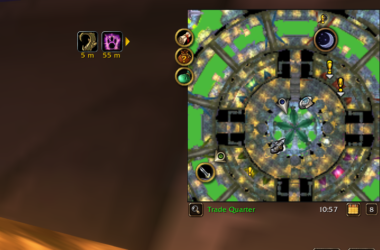
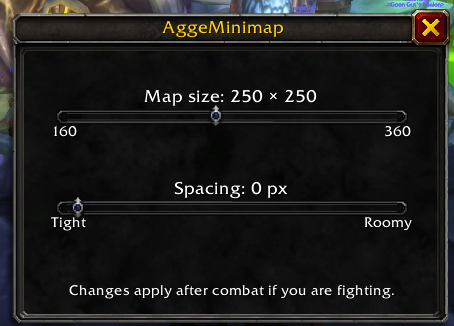
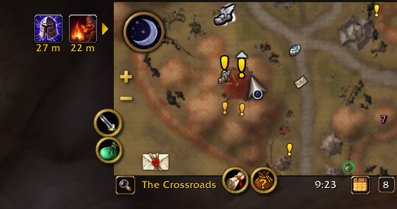

# AggeMinimap

**[Download on CurseForge](https://www.curseforge.com/wow/addons/aggeminimap)** · [GitHub release](https://github.com/arwebSE/AggeMinimap/releases/latest)

A clean square or rectangular minimap for **WoW Forever**.



<details>
<summary>Settings and wide layout</summary>





</details>

- Separate width and height sliders, linked by default, plus spacing from −20 to 40 px.
- Compact header above or below the map.
- Move and scale with Blizzard Edit Mode.

Right-click the minimap, type **`/amm`**, or open **Options → AddOns → AggeMinimap** for settings. Defaults are **200 × 200** with **0 px spacing**; use **Reset defaults** to restore them.

For **Forever 1.60.1**. Use one minimap skin at a time.

[Report an issue](https://github.com/arwebSE/AggeMinimap/issues) · [AggeHealBot](https://www.curseforge.com/wow/addons/aggehealbot)

<details>
<summary>Manual installation</summary>

Extract the addon ZIP into your Forever client's `Interface/AddOns` folder. The path should be `Interface/AddOns/AggeMinimap/AggeMinimap.toc`. Restart the game after first installation.

</details>

<details>
<summary>Development and verification</summary>

Requires Node.js and PowerShell 7.

```powershell
npm ci
npm test
./scripts/package.ps1
```

Automated tests check Lua syntax, manifests, rectangular dimensions, aspect linking, negative spacing, scaled header layouts, settings, load order and combat deferral in a simulated WoW environment. Client behavior and appearance also require in-game verification when changes are made. See [release testing](docs/TESTING.md).

The WoW simulation and behavior tests live in `tests/runtime.lua` and can also run directly with Lua 5.1+. `npm test` runs them in both loading modes through a small Node launcher, which also checks syntax, manifests, and textures.

The package script includes the addon, license, README and changelog. Local backups, development dependencies and submission assets are excluded. No external libraries or polling timers are required by the addon.

</details>

[MIT license](LICENSE).
